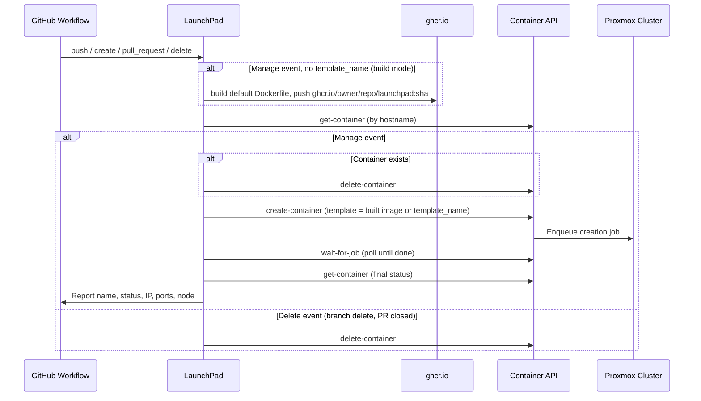

# MIEWeb LaunchPad

GitHub Action that deploys your repository as an LXC container on an [opensource-server](https://github.com/mieweb/opensource-server) Proxmox cluster via the Container API. Point it at a Node.js repo with zero configuration and it builds a systemd-enabled image, pushes it to ghcr.io, and deploys it — or hand it a pre-built image via `template_name`. It derives a container name from your repository and branch, decides when to create/recreate/delete, and delegates every API call to the reusable composite actions in [mieweb/opensource-server/.github/actions](https://github.com/mieweb/opensource-server/tree/main/.github/actions).

## Prerequisites

- An API key for the create-a-container server (request one from your site admin)
- **Build mode** (no `template_name`): a public repository — the image package inherits the repo's visibility at first publish, and the cluster pulls anonymously. Private repos need a one-time manual package visibility flip on ghcr.io.
- **Traditional mode**: a Docker/OCI image published to a public container registry (GHCR, Docker Hub, etc.)

## Application Lifecycle (Build Mode)

When `template_name` is omitted on a manage event, LaunchPad builds the checked-out repository with a default Dockerfile that models a standard application lifecycle, assuming a Node.js app by default:

| # | Stage | Input | Default |
|---|-------|-------|---------|
| 1 | Dependencies | `dependency_command` | `npm ci --no-audit --no-fund` |
| 2 | Configure | `build_command` | *(empty — skipped)* |
| 3 | Build | `build_command` (same input, e.g. `./configure && make`) | *(empty — skipped)* |
| 4 | Install | built into the image: repo copied to `working_directory`, systemd unit installed and enabled | — |
| 5 | Run | `run_command`, executed by `app.service` | `npm start` |

The image is based on `base_image` (systemd + Docker-in-Docker enabled), tagged `ghcr.io/<owner>/<repo>/launchpad:<commit sha>` (override with `image`), and pushed with the workflow's `GITHUB_TOKEN`. The generated `app.service` sets `Documentation=` to your repository URL, runs in `working_directory`, and loads container environment variables from `/etc/environment`.

Requirements and limits:

- Run `actions/checkout` before this action, and grant the job `permissions: contents: read, packages: write`.
- A `run_command` containing single quotes or newlines breaks the generated unit — commit a script to your repo and use that instead (or use the traditional path with your own Dockerfile).
- A custom `base_image` must be systemd-enabled and provide `envsubst` (Debian package `gettext-base`).
- The `image` override must be under `ghcr.io/<owner>/` so `GITHUB_TOKEN` can push it.

> **Breaking change:** previously, omitting `template_name` on a manage event reused an existing container as-is. It now builds and deploys from the repository. Cleanup-only jobs (PR close / branch delete) are unaffected — they never build.

## Repository Secrets

Add these in **Settings > Secrets and variables > Actions**:

| Secret | Description |
|--------|-------------|
| `API_KEY` | API key for the create-a-container server |
| `API_URL` | Base URL of the create-a-container server |

## Inputs

| Input | Required | Default | Description |
|-------|----------|---------|-------------|
| `api_key` | Yes | — | Bearer token for authenticating with the Container API |
| `api_url` | Yes | — | Base URL of the create-a-container server |
| `template_name` | No | — | Docker/OCI image reference to deploy (e.g., `ghcr.io/org/app:tag`). When provided, an existing container is deleted and recreated with the new template. **When omitted on a manage event, LaunchPad builds the repository instead (build mode).** |
| `container_env_vars` | No | — | Environment variables to set inside the container (JSON string, e.g., `'{"NODE_ENV": "production"}'`) |
| `services` | No | — | Services configuration (JSON array string) |
| `site_id` | No | `1` | Site ID for the container management system |
| `image` | No | `ghcr.io/<owner>/<repo>/launchpad:<sha>` | Build mode: full image reference to build and push. Must be under `ghcr.io/<owner>/` |
| `base_image` | No | `ghcr.io/mieweb/opensource-server/docker-nodejs:latest` | Build mode: base image for the default Dockerfile |
| `working_directory` | No | `/workspace` | Build mode: where the repository is copied inside the image |
| `dependency_command` | No | `npm ci --no-audit --no-fund` | Build mode: dependency install command |
| `build_command` | No | *(empty — skipped)* | Build mode: configure/build command (e.g. `./configure && make`) |
| `run_command` | No | `npm start` | Build mode: command `app.service` runs |

Build-mode inputs are ignored when `template_name` is provided.

## Outputs

| Output | Description |
|--------|-------------|
| `image` | The image reference built and pushed by build mode (empty on the traditional `template_name` path) |

## Supported Workflow Events

| Event | Action |
|-------|--------|
| `push` | Creates or recreates the container for the branch (skipped when the push created the branch — the `create` event handles it) |
| `create` | Creates a container for the new branch |
| `workflow_dispatch` | Creates or recreates the container for the current branch |
| `pull_request` (opened/synchronize/reopened) | Creates or recreates the container for the PR head branch |
| `pull_request` (closed) | Deletes the container |
| `delete` | Deletes the container for the deleted branch |

## Container Naming

Containers are named `<owner>-<repo>-<branch>`, lowercased, with any character outside `[a-z0-9-]` replaced by `-`. Names longer than 63 characters (DNS label limit) are truncated to 54 characters plus a `-` and an 8-character hash of the remainder. Template tags containing `/` are normalized to `-` to match `docker/metadata-action` behavior.

## How It Works



The action is a dispatcher over three sub-actions in this repository — [build](https://github.com/mieweb/launchpad/tree/main/build), [manage](https://github.com/mieweb/launchpad/tree/main/manage), and [delete](https://github.com/mieweb/launchpad/tree/main/delete) — which delegate each API call to a thin composite action: [get-container](https://github.com/mieweb/opensource-server/tree/main/.github/actions/get-container), [create-container](https://github.com/mieweb/opensource-server/tree/main/.github/actions/create-container), [delete-container](https://github.com/mieweb/opensource-server/tree/main/.github/actions/delete-container), [wait-for-job](https://github.com/mieweb/opensource-server/tree/main/.github/actions/wait-for-job).

The action fails if the container is not found after creation or its final status is not `running`.

## Basic Usage — Zero-Config Build & Deploy

For a Node.js repository, this is all you need. On every push, LaunchPad builds the repo into a systemd-enabled image, pushes it to ghcr.io, and deploys it:

```yaml
name: Deploy

on:
  push:

permissions:
  contents: read
  packages: write

jobs:
  deploy:
    runs-on: ubuntu-latest
    steps:
      - uses: actions/checkout@v4

      - uses: mieweb/launchpad@main
        with:
          api_key: ${{ secrets.API_KEY }}
          api_url: ${{ secrets.API_URL }}
```

Override any lifecycle stage as needed:

```yaml
      - uses: mieweb/launchpad@main
        with:
          api_key: ${{ secrets.API_KEY }}
          api_url: ${{ secrets.API_URL }}
          dependency_command: npm ci --no-audit --no-fund && pip install -r requirements.txt
          build_command: npm run build
          run_command: node dist/server.js
```

## Basic Usage — Pre-Built Image

Build and push the image yourself (any Dockerfile, any workflow), then hand LaunchPad the reference:

```yaml
- uses: mieweb/launchpad@main
  with:
    api_key: ${{ secrets.API_KEY }}
    api_url: ${{ secrets.API_URL }}
    template_name: ghcr.io/your-org/your-app:latest
```

## PR Preview Environments

Deploy preview containers on pull requests and clean them up when the PR closes:

```yaml
name: PR Preview

on:
  pull_request:
    types: [opened, synchronize, reopened, closed]

jobs:
  deploy-preview:
    if: github.event.action != 'closed'
    runs-on: ubuntu-latest
    steps:
      - uses: actions/checkout@v4

      - uses: mieweb/launchpad@main
        with:
          api_key: ${{ secrets.API_KEY }}
          api_url: ${{ secrets.API_URL }}
          template_name: ghcr.io/your-org/your-app:pr-${{ github.event.pull_request.number }}

  cleanup-preview:
    if: github.event.action == 'closed'
    runs-on: ubuntu-latest
    steps:
      - uses: actions/checkout@v4

      - uses: mieweb/launchpad@main
        with:
          api_key: ${{ secrets.API_KEY }}
          api_url: ${{ secrets.API_URL }}
```

`template_name` is not needed for cleanup — the closed PR event triggers deletion of the container associated with the PR head branch. Omitting `template_name` triggers build mode only on manage events; `closed` events go straight to deletion.

## Complete Example: Build + Deploy

Build an image, push it to GHCR, and deploy a preview container on every PR:

```yaml
name: Build and Deploy Preview

on:
  pull_request:
    types: [opened, synchronize, reopened, closed]

env:
  REGISTRY: ghcr.io

jobs:
  build-and-push:
    if: github.event.action != 'closed'
    runs-on: ubuntu-latest
    permissions:
      contents: read
      packages: write
    steps:
      - uses: actions/checkout@v4

      - uses: docker/setup-buildx-action@v3

      - uses: docker/login-action@v3
        with:
          registry: ${{ env.REGISTRY }}
          username: ${{ github.actor }}
          password: ${{ secrets.GITHUB_TOKEN }}

      - uses: docker/metadata-action@v5
        id: meta
        with:
          images: ${{ env.REGISTRY }}/${{ github.repository }}
          tags: |
            type=ref,event=pr

      - uses: docker/build-push-action@v6
        with:
          push: true
          tags: ${{ steps.meta.outputs.tags }}

  deploy-preview:
    if: github.event.action != 'closed'
    needs: build-and-push
    runs-on: ubuntu-latest
    steps:
      - uses: actions/checkout@v4

      - uses: mieweb/launchpad@main
        with:
          api_key: ${{ secrets.API_KEY }}
          api_url: ${{ secrets.API_URL }}
          template_name: ${{ env.REGISTRY }}/${{ github.repository }}:pr-${{ github.event.pull_request.number }}

  cleanup-preview:
    if: github.event.action == 'closed'
    runs-on: ubuntu-latest
    steps:
      - uses: actions/checkout@v4

      - uses: mieweb/launchpad@main
        with:
          api_key: ${{ secrets.API_KEY }}
          api_url: ${{ secrets.API_URL }}
```

## Output

After a successful manage run, the workflow log reports the container details:

```
━━━━━━━━━━━━━━━━━━━━━━━━━━━━━━━━━━━━━━━━━━━━━━━━━━━━━━━━━━━━
  Container : your-org-your-app-feature-branch
  Status    : running
  IP        : 10.15.129.23
  SSH Port  : 2344
  HTTP Port : 32000
  Node      : opensource-phxdc-pve1
━━━━━━━━━━━━━━━━━━━━━━━━━━━━━━━━━━━━━━━━━━━━━━━━━━━━━━━━━━━━
```

## Misc.
Originally written by [maxklema](https://github.com/maxklema). Rewritten for the Container API by Carter Myers (https://github.com/cmyers-mieweb)).<br>
Feel free to submit a PR/issue here.